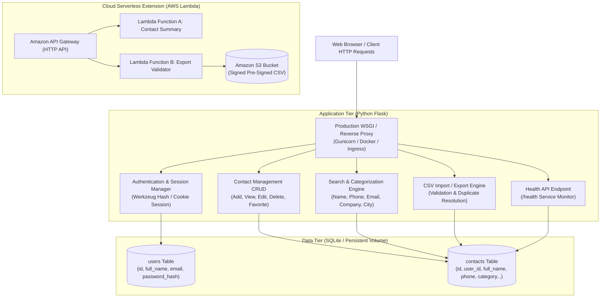
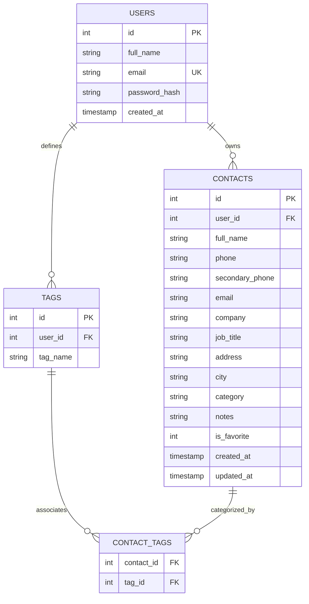

# ContactHub — System Architecture & Design

This document details the architectural blueprint, data flow, component interactions, and deployment tiers of **ContactHub — Contact Management System**.

---

## 1. System Architecture Diagram

---

## 2. Multi-Tier Architecture Details

### Presentation Tier (Frontend)
- **HTML5 & CSS3:** Semantic markup and modern custom styling following the Navy (`#0f172a`), White (`#ffffff`), and Teal (`#0d9488`) color palette.
- **Bootstrap 5 & Bootstrap Icons:** Mobile-responsive grid layout, responsive sidebar navigation, cards, badges, and modals.
- **Vanilla JavaScript (`main.js`):** Client-side validation, mobile sidebar toggling, asynchronous favorite star updates via Fetch API, and auto-dismissing flash alerts.

### Application Tier (Backend)
- **Python 3 Flask:** Lightweight microframework utilizing the Application Factory pattern (`create_app`).
- **Security & Session Management:** Client session encrypted with HMAC secret key (`SECRET_KEY`), strict login decorators (`@login_required`), Werkzeug scrypt/pbkdf2 password hashing.
- **CSRF Token Validation:** Form and header token validation preventing cross-site request forgery attacks.
- **Parameterized SQL:** All queries use `?` placeholders preventing SQL injection vulnerabilities.
- **Strict Data Isolation:** Every database query enforces `WHERE user_id = session['user_id']`, guaranteeing that users cannot view, edit, delete, or export contacts belonging to other registered users (preventing Insecure Direct Object References - IDOR).

### Data Tier (Database)
- **SQLite Database (`database/contacthub.db`):** Serverless, zero-configuration relational database engine ideal for lightweight laptop execution, testing, and single-container deployments.
- **Indexes:** Dedicated B-Tree indexes on `user_id`, `full_name`, `category`, `is_favorite`, `email`, and `phone` ensuring $O(\log n)$ search performance.
- **Foreign Keys:** Enforced `ON DELETE CASCADE` constraints between `users` and `contacts`.

---

## 3. Database Entity-Relationship (ER) Diagram

---

## 4. Five-Stage Deployment Progression

ContactHub is engineered to demonstrate the five distinct evolutionary stages of modern software deployment covered in the BCA curriculum:

1. **Bare-Metal / Local Virtualization (Module 1):** Running inside an Ubuntu Virtual Machine on Type-2 hypervisors (VirtualBox / VMware).
2. **Automated Virtualization (Module 2):** Automating VM lifecycle (start, stop, reboot) using Linux KVM, QEMU, libvirt, and shell scripts.
3. **Containerization (Module 3):** Encapsulating dependencies into a reproducible Docker container, served via Gunicorn WSGI and orchestrated with Docker Compose.
4. **Container Orchestration (Module 4):** Deploying across Kubernetes / Minikube clusters with Deployments, ReplicaSets, ClusterIP/NodePort Services, ConfigMaps, Secrets, and rolling update self-healing capabilities.
5. **Serverless Architecture (Module 5):** Offloading event-driven statistical generation and bulk export workflows to AWS Lambda and Amazon API Gateway HTTP API.
