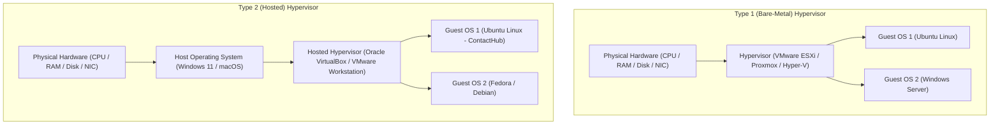

# Module 1 — Introduction to Virtualization

This practical guide fulfills the syllabus requirements for **Module 1: Introduction to Virtualization** for the ContactHub BCA microproject.

> **Note for Local Windows Development:**
> Installing an entire VirtualBox VM is **optional** for running ContactHub on your development laptop. The application can run natively on Windows via Python. This module serves as the conceptual reference and practical guide for students conducting virtualization lab experiments or presenting in project viva.

---

## 1. What is Virtualization?

Virtualization is a foundational computing technology that enables multiple simulated operating systems and environments to run concurrently on a single physical host machine. 

A software layer known as the **Hypervisor** (or Virtual Machine Monitor - VMM) abstracts physical hardware resources (CPU cores, RAM memory, storage, and network interfaces) into virtualized equivalents.

---

## 2. Physical Machines vs. Virtual Machines

| Feature | Physical Machine (Bare Metal) | Virtual Machine (VM) |
| :--- | :--- | :--- |
| **Operating System** | Single OS installed directly on hardware | Multiple guest OS instances run concurrently |
| **Hardware Coupling** | Tightly coupled with host motherboard, CPU, BIOS | Decoupled; hardware presented through virtual drivers |
| **Portability** | Difficult; tied to underlying physical hardware | High; represented as portable disk files (`.vdi`, `.vmdk`, `.ova`) |
| **Snapshots & Backups**| Requires disk imaging tools; prone to hardware conflicts | Instant point-in-time state capture within seconds |
| **Resource Utilization** | Often low (10% to 25% average server load) | High (60% to 80% consolidated utilization) |
| **Isolation** | Physical hardware isolation | Logical hypervisor-enforced sandboxing |

---

## 3. Type 1 vs. Type 2 Hypervisors



### Detailed Comparison Table

| Property | Type 1 Hypervisor (Bare-Metal) | Type 2 Hypervisor (Hosted) |
| :--- | :--- | :--- |
| **Installation** | Installed directly on bare-metal physical hardware | Installed as an application on top of an existing host OS |
| **Performance** | Near-native speed; direct access to hardware | Slight overhead due to passing through host OS kernel |
| **Latency** | Minimal latency; enterprise grade | Moderate latency suitable for testing and development |
| **Host Dependency**| Zero host OS dependency | If host OS crashes, all guest VMs terminate |
| **Target Audience** | Enterprise data centers, cloud infrastructure | Developers, students, lab testing, individual workstations |
| **Examples** | VMware ESXi, Proxmox VE, Microsoft Hyper-V, KVM | Oracle VirtualBox, VMware Workstation Player, Parallels Desktop |

---

## 4. Setting Up a Virtual Machine for ContactHub

### Step A: Download & Install Oracle VirtualBox
1. Download **Oracle VM VirtualBox** for Windows from [virtualbox.org](https://www.virtualbox.org/).
2. Run the installer and accept default networking interfaces.
3. Download the official **Ubuntu 22.04 LTS / 24.04 LTS Desktop ISO** image.

### Step B: Create the Ubuntu Virtual Machine
1. Open VirtualBox and click **New**.
2. Set Name: `ContactHub-Ubuntu-VM`, Type: `Linux`, Version: `Ubuntu (64-bit)`.
3. Allocate Hardware Specifications:
   - **Base Memory (RAM):** 4096 MB (4 GB recommended for desktop, 2048 MB for server).
   - **Processors (vCPU):** 2 virtual CPUs.
   - **Virtual Hard Disk:** Create a VDI (VirtualBox Disk Image) with **25 GB** dynamically allocated storage.
4. Mount ISO: Navigate to `Settings -> Storage -> Controller: IDE/SATA`, click optical drive and select your Ubuntu ISO.
5. Complete standard Ubuntu operating system installation.

---

## 5. Running ContactHub Inside Ubuntu Virtual Machine

Once your Ubuntu VM boots into the desktop, open the terminal (`Ctrl + Alt + T`) and execute:

```bash
# 1. Update Ubuntu packages
sudo apt update && sudo apt upgrade -y

# 2. Install Python 3, pip, and Git
sudo apt install -y python3 python3-pip python3-venv git sqlite3

# 3. Clone or copy ContactHub project
git clone https://github.com/yourusername/ContactHub.git
cd ContactHub

# 4. Create and activate Python virtual environment
python3 -m venv venv
source venv/bin/activate

# 5. Install required dependencies
pip install -r requirements.txt

# 6. Initialize and seed SQLite database
python3 database/seed_data.py

# 7. Start ContactHub server
python3 app.py
```

Open Firefox inside the Ubuntu guest VM and visit `http://127.0.0.1:5000`.

---

## 6. VirtualBox Port Forwarding (Host to Guest Access)

To access ContactHub running inside the Ubuntu VM from your host Windows machine browser:
1. In VirtualBox, navigate to `Settings -> Network -> Adapter 1 (NAT)`.
2. Click **Advanced -> Port Forwarding**.
3. Add a new rule:
   - **Name:** `ContactHub`
   - **Protocol:** `TCP`
   - **Host IP:** `127.0.0.1`
   - **Host Port:** `8080`
   - **Guest IP:** *(leave blank)*
   - **Guest Port:** `5000`
4. On your Windows host browser, open `http://localhost:8080`.

---

## 7. VM Snapshots and Cloning

### Taking a Point-in-Time Snapshot
Snapshots preserve the exact disk state and memory configuration of a virtual machine at a specific moment.
- **Why use snapshots in ContactHub?** Before applying major database migrations, OS updates, or testing risky configurations, take a snapshot named `Before-Database-Upgrade`.
- **How to create:** VirtualBox menu `Machine -> Take Snapshot -> Name: Clean-Install`.
- **How to restore:** VirtualBox `Snapshots -> Select Snapshot -> Restore`.

### Full Clone vs. Linked Clone
- **Full Clone:** A completely independent duplicate copy of the virtual machine including virtual disk files. Takes more storage space but operates independently if the original VM is deleted.
- **Linked Clone:** A lightweight copy that shares virtual disks with the parent VM. Consumes minimal storage initially but depends on the master snapshot remaining intact.

---

## 8. Advantages & Limitations of Virtualization

### Advantages
1. **Hardware Consolidation:** Run multiple OS environments on one physical machine, reducing electricity and hardware costs.
2. **Safe Sandboxing:** Faulty code or malware in guest VM cannot breach the host OS.
3. **Rapid Disaster Recovery:** Snapshots can restore systems within seconds.
4. **Legacy Application Support:** Run legacy software needing older OS versions.

### Limitations
1. **Resource Overhead:** Each VM runs its own full operating system kernel, requiring separate RAM, disk, and CPU allocations.
2. **Slower Startup Time:** Booting a VM takes 30 to 60 seconds (compared to sub-second container startup in Docker).
3. **Storage Footprint:** Virtual hard disks typically consume 15 GB to 30 GB per VM.
