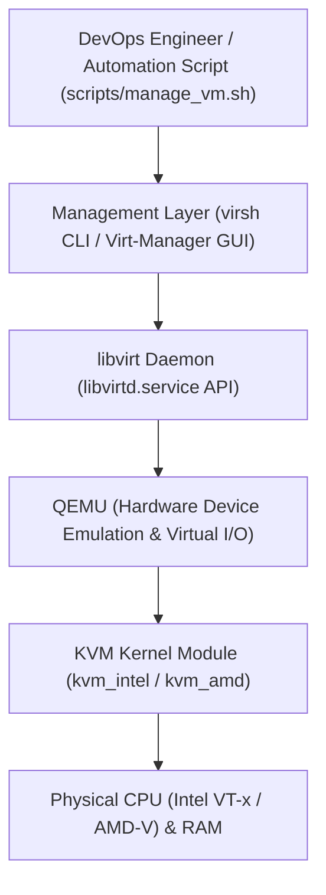

# Module 2 — Virtualization Tools and Automation

This guide covers **Module 2: Virtualization Tools and Automation** for the ContactHub BCA microproject, focusing on **KVM (Kernel-based Virtual Machine)**, **QEMU**, **libvirt**, and automated lifecycle management via shell scripting.

> **Environment Clarification:**
> Native KVM virtualization requires a Linux host kernel with hardware virtualization extensions (Intel VT-x or AMD-V). If you are running on a Windows workstation, you can run KVM inside an Ubuntu VM with nested virtualization enabled or test the shell scripts inside WSL2 / Linux. On Windows, PowerShell commands are used for local project workflows.

---

## 1. Core Architecture: KVM, QEMU, and libvirt



### 1. KVM (Kernel-based Virtual Machine)
KVM is an open-source virtualization module integrated directly into the Linux kernel. It turns the Linux kernel into a Type-1 bare-metal hypervisor, allowing CPU instructions from guest operating systems to execute directly on the physical processor.

### 2. QEMU (Quick Emulator)
While KVM handles CPU and memory virtualization, QEMU emulates peripheral hardware components: virtual network interfaces (NICs), virtual disks (VirtIO), graphics adapters, and USB controllers.

### 3. libvirt
`libvirt` provides a unified, cross-platform C-API, daemon (`libvirtd`), and management toolset (`virsh`) to inspect, configure, and automate virtual machines consistently.

---

## 2. Checking Hardware Virtualization Support

Before configuring KVM on a Linux machine, verify that your CPU has hardware virtualization extensions enabled:

### On Linux (Ubuntu / Debian):
```bash
# Check for Intel (vmx) or AMD (svm) CPU flags
egrep -c '(vmx|svm)' /proc/cpuinfo
```
- If the output is **1 or greater**, hardware virtualization is enabled.
- If the output is **0**, virtualization must be enabled in your computer's BIOS/UEFI firmware (Intel VT-x or AMD-V).

Alternatively, run:
```bash
sudo kvm-ok
```
Expected output:
```
INFO: /dev/kvm exists
KVM acceleration can be used
```

### On Windows PowerShell (Verification Only):
```powershell
Get-ComputerInfo -Property "HyperV*"
```

---

## 3. Automated KVM Setup (`scripts/setup_kvm.sh`)

To eliminate manual package installation and configuration errors, ContactHub includes an automated setup script: [scripts/setup_kvm.sh](file:///C:/Users/ALBIN%20SHIJI/.gemini/antigravity/scratch/ContactHub/scripts/setup_kvm.sh).

Execute on your Linux host/VM:
```bash
chmod +x scripts/setup_kvm.sh
sudo ./scripts/setup_kvm.sh
```

### What this script automates:
1. Validates CPU virtualization extensions (`vmx`/`svm`).
2. Installs `qemu-kvm`, `libvirt-daemon-system`, `libvirt-clients`, `bridge-utils`, and `virtinst`.
3. Enables and starts the `libvirtd` systemd service.
4. Grants the current non-root user membership in `kvm` and `libvirt` groups.
5. Verifies libvirt connection using `virsh list --all`.

---

## 4. Virtual Machine Automation Script (`scripts/manage_vm.sh`)

The script [scripts/manage_vm.sh](file:///C:/Users/ALBIN%20SHIJI/.gemini/antigravity/scratch/ContactHub/scripts/manage_vm.sh) provides a robust, menu-driven CLI interface to automate the entire lifecycle of virtual machines using `virsh`.

### Available Commands

| Command | Action | Underlying virsh Invocation |
| :--- | :--- | :--- |
| `./scripts/manage_vm.sh list` | List all registered VMs and their status | `virsh list --all` |
| `./scripts/manage_vm.sh start <vm>` | Powers on the specified VM | `virsh start <vm-name>` |
| `./scripts/manage_vm.sh stop <vm>` | Sends graceful ACPI shutdown signal | `virsh shutdown <vm-name>` |
| `./scripts/manage_vm.sh force-stop <vm>`| Forcefully terminates VM power | `virsh destroy <vm-name>` |
| `./scripts/manage_vm.sh restart <vm>` | Reboots the specified VM | `virsh reboot <vm-name>` |
| `./scripts/manage_vm.sh status <vm>` | Shows current state (running, shut off)| `virsh domstate <vm-name>` |
| `./scripts/manage_vm.sh info <vm>` | Displays vCPU, RAM, and hardware stats | `virsh dominfo <vm-name>` |

### Demonstration Examples

```bash
# 1. List all virtual machines
./scripts/manage_vm.sh list

# 2. Power on the ContactHub VM
./scripts/manage_vm.sh start contacthub-vm

# 3. Check VM execution state
./scripts/manage_vm.sh status contacthub-vm

# 4. View hardware domain info
./scripts/manage_vm.sh info contacthub-vm

# 5. Gracefully shutdown the VM
./scripts/manage_vm.sh stop contacthub-vm
```

---

## 5. Creating a VM via CLI (`virt-install`)

For complete hands-off headless VM creation, `virt-install` can provision a guest without using a graphical user interface:

```bash
sudo virt-install \
  --name contacthub-server \
  --ram 2048 \
  --vcpus 2 \
  --disk path=/var/lib/libvirt/images/contacthub.qcow2,size=20,format=qcow2 \
  --os-variant ubuntu22.04 \
  --network network=default \
  --graphics none \
  --location 'http://archive.ubuntu.com/ubuntu/dists/jammy/main/installer-amd64/' \
  --extra-args 'console=ttyS0,115200n8 serial'
```

---

## 6. Running ContactHub Inside an Automated KVM Environment

Once the Linux guest VM is booted:
1. Connect via SSH:
   ```bash
   ssh user@<vm-ip-address>
   ```
2. Clone repository and run ContactHub:
   ```bash
   git clone https://github.com/yourusername/ContactHub.git
   cd ContactHub
   python3 -m venv venv
   source venv/bin/activate
   pip install -r requirements.txt
   python3 database/seed_data.py
   python3 app.py
   ```
3. Test connectivity from the host machine:
   ```bash
   curl http://<vm-ip-address>:5000/health
   ```
