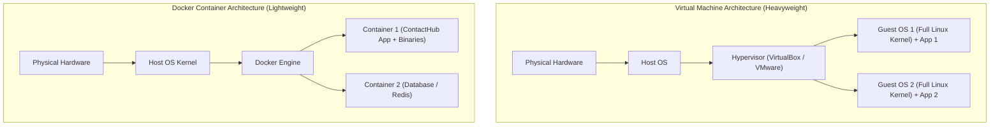

# Module 3 — Containerization Using Docker & Docker Hub

This guide details the containerization of **ContactHub** using **Docker**, **Docker Compose**, and **Docker Hub** for the BCA microproject.

---

## 1. Containers vs. Virtual Machines



### Key Differences Table

| Property | Virtual Machine (VM) | Docker Container |
| :--- | :--- | :--- |
| **Operating System** | Ships with complete guest OS kernel | Shares host OS kernel; contains only application & binaries |
| **Startup Time** | Minutes (30s – 2min) | Sub-second (milliseconds to seconds) |
| **Size on Disk** | 10 GB – 40 GB per VM | 100 MB – 500 MB per image |
| **Resource Overhead** | High (RAM & CPU pinned to each VM) | Low (consumes only active process memory) |
| **Isolation** | Hardware-level hypervisor boundary | Process-level Linux namespaces & cgroups |

---

## 2. Dockerfile Deep Dive

ContactHub uses a hardened, multi-stage production Dockerfile: [Dockerfile](file:///C:/Users/ALBIN%20SHIJI/.gemini/antigravity/scratch/ContactHub/Dockerfile).

```dockerfile
FROM python:3.12-slim
```
- **Base Image:** `python:3.12-slim` is based on Debian slim, keeping the final image lightweight (~180MB) while offering security updates.

```dockerfile
ENV PYTHONDONTWRITEBYTECODE=1 \
    PYTHONUNBUFFERED=1 \
    PORT=5000 \
    DATABASE_PATH=/app/database/contacthub.db
```
- **Environment Flags:** Prevents Python from writing temporary `.pyc` files and forces unbuffered stdout/stderr logging so container logs appear in real-time.

```dockerfile
RUN groupadd -g 1000 contactuser && \
    useradd -u 1000 -g contactuser -s /bin/bash -m contactuser
```
- **Least-Privilege Security:** Never run production containers as `root`. We create a dedicated user `contactuser` (UID 1000) and grant ownership of `/app/database`.

```dockerfile
HEALTHCHECK --interval=30s --timeout=5s --start-period=10s --retries=3 \
    CMD curl -f http://localhost:5000/health || exit 1
```
- **Automated Healthcheck:** Periodically queries the `/health` endpoint. If the app or SQLite crashes, Docker marks the container status as `unhealthy`.

```dockerfile
CMD ["gunicorn", "--bind", "0.0.0.0:5000", "--workers", "4", "app:app"]
```
- **Production WSGI Server:** Gunicorn with 4 worker processes handles concurrent client connections efficiently.

---

## 3. Docker Ignore (`.dockerignore`)

The [.dockerignore](file:///C:/Users/ALBIN%20SHIJI/.gemini/antigravity/scratch/ContactHub/.dockerignore) file prevents sensitive and temporary files from being copied into the container build context:
- Virtual environments (`venv/`)
- Secret keys and environment files (`.env`, `secret.yaml`)
- Temporary SQLite development files (`database/*.db`)
- Pytest cache and test coverage files (`.pytest_cache/`)
- Git history (`.git`)

---

## 4. Docker CLI Commands on Windows PowerShell

Ensure Docker Desktop is running before executing these commands in Windows PowerShell:

### Step 1: Verify Docker Installation
```powershell
docker --version
docker info
```

### Step 2: Build the ContactHub Docker Image
```powershell
docker build -t contacthub:v1.0 .
```

### Step 3: Run the Container Standalone
```powershell
docker run -d `
  --name contacthub-app `
  -p 5000:5000 `
  -e SECRET_KEY="contacthub-docker-demo-secret" `
  -v contacthub-data:/app/database `
  contacthub:v1.0
```

### Step 4: Inspect Running Containers
```powershell
# List active running containers
docker ps

# Inspect logs output
docker logs contacthub-app

# Inspect container health and network details
docker inspect contacthub-app
```

### Step 5: Test Health and Web Access
Open your web browser and visit:
- Application UI: `http://localhost:5000`
- Health Endpoint: `http://localhost:5000/health`

### Step 6: Stop and Clean Up Standalone Container
```powershell
docker stop contacthub-app
docker rm contacthub-app
```

---

## 5. Docker Compose Automation

Docker Compose simplifies multi-parameter container orchestration into a single YAML configuration: [docker-compose.yml](file:///C:/Users/ALBIN%20SHIJI/.gemini/antigravity/scratch/ContactHub/docker-compose.yml).

### Persistent Named Volume for SQLite
In `docker-compose.yml`, the volume configuration:
```yaml
volumes:
  - contacthub-data:/app/database
```
guarantees that even if the container is stopped, deleted, or upgraded, your contacts database stored in `contacthub-data` remains permanently intact on the host storage.

### Docker Compose Commands

```powershell
# 1. Build and start container in detached background mode
docker compose up -d --build

# 2. Check container status
docker compose ps

# 3. View live application logs
docker compose logs -f

# 4. Stop and remove containers (preserving data volume)
docker compose down

# 5. Stop and delete everything including the data volume
docker compose down -v
```

---

## 6. Publishing Image to Docker Hub (Registry Practice)

Docker Hub is a global cloud container registry used to distribute Docker images.

> **Instruction for Students:** Replace `YOUR_DOCKERHUB_USERNAME` below with your real registered Docker Hub account handle.

```powershell
# 1. Authenticate with Docker Hub
docker login

# 2. Tag local image with your Docker Hub repository name
docker tag contacthub:v1.0 YOUR_DOCKERHUB_USERNAME/contacthub:v1.0
docker tag contacthub:v1.0 YOUR_DOCKERHUB_USERNAME/contacthub:latest

# 3. Push images to Docker Hub
docker push YOUR_DOCKERHUB_USERNAME/contacthub:v1.0
docker push YOUR_DOCKERHUB_USERNAME/contacthub:latest

# 4. Pull and run image on any machine
docker pull YOUR_DOCKERHUB_USERNAME/contacthub:v1.0
docker run -d -p 5000:5000 YOUR_DOCKERHUB_USERNAME/contacthub:v1.0
```
