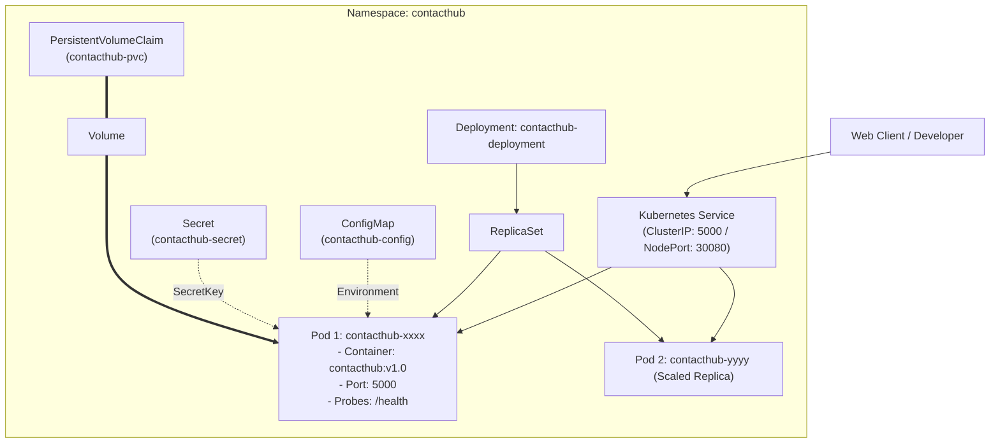

# Module 4 — Container Orchestration with Kubernetes

This guide covers **Module 4: Container Orchestration with Kubernetes** for the ContactHub BCA microproject, explaining how to manage, scale, and self-heal containers using **Kubernetes**, **Minikube**, and **kubectl**.

---

## 1. Why Container Orchestration?

Running a single container via `docker run` works for small local testing. However, in production systems:
- If a container crashes, it must be restarted automatically (**Self-Healing**).
- If website traffic surges, additional replicas must be spawned across multiple servers (**Horizontal Scaling**).
- Updating application versions must happen without taking down the service (**Zero-Downtime Rolling Updates**).
- Network traffic must be routed and load-balanced across healthy pods (**Service Discovery & Load Balancing**).

Kubernetes (K8s) is the industry-standard container orchestration platform that automates these operations.

---

## 2. Core Kubernetes Concepts



### Definitions

1. **Pod:** The smallest deployable computing unit in Kubernetes. Encapsulates one or more closely coupled containers sharing network IP and storage.
2. **Deployment:** Declarative controller that manages Pod creation, replica count, updates, and rollbacks.
3. **ReplicaSet:** Underlying controller managed by Deployment that ensures a specified number of identical Pods are running at all times.
4. **Service:** An abstraction defining a logical set of Pods and a policy to access them:
   - **ClusterIP:** Internal IP address accessible only from within the Kubernetes cluster.
   - **NodePort:** Exposes the Service on each Node's static port (e.g. `30080`), enabling external browser access from the host.
5. **ConfigMap:** Decouples non-sensitive configuration artifacts from container image content.
6. **Secret:** Stores sensitive data (e.g. `SECRET_KEY`) securely in encoded format.
7. **Liveness Probe:** Periodically checks if the application is alive. If the probe fails, Kubernetes kills and restarts the Pod.
8. **Readiness Probe:** Checks if the Pod is ready to accept incoming user traffic. Traffic is withheld until the probe passes.

---

## 3. Important Architecture Note: SQLite vs. Shared Database

> **Critical Concept for Viva:**
> ContactHub uses an embedded **SQLite** database stored on a PersistentVolumeClaim (`contacthub-pvc`).
> - **Single Replica (1 Pod):** Perfectly suited for laptop practicals, development, and college demonstrations. Data is persistent and fast.
> - **Multi-Pod Horizontal Scaling:** In enterprise cloud environments, running multiple concurrent replicas with an independent SQLite file is not recommended because SQLite does not support distributed multi-master network replication.
> - **Solution for Scale:** For large-scale production horizontal autoscaling, the stateless Flask web layer connects to a managed multi-node database such as **PostgreSQL**, **MySQL**, or **Amazon Aurora**.

---

## 4. Complete Windows Setup Workflow

### Step 1: Start Minikube
```powershell
minikube start --driver=docker
kubectl get nodes
```

### Step 2: Build and Load Docker Image
```powershell
# Build local Docker image
docker build -t contacthub:v1.0 .

# Load directly into Minikube VM cache
minikube image load contacthub:v1.0
```

### Step 3: Create Secret from Example
```powershell
Copy-Item kubernetes/secret.yaml.example kubernetes/secret.yaml
```

### Step 4: Apply Manifests in Order
```powershell
kubectl apply -f kubernetes/namespace.yaml
kubectl apply -f kubernetes/configmap.yaml
kubectl apply -f kubernetes/secret.yaml
kubectl apply -f kubernetes/pvc.yaml
kubectl apply -f kubernetes/deployment.yaml
kubectl apply -f kubernetes/service.yaml
```

### Step 5: Verify Running Cluster State
```powershell
kubectl get pods -n contacthub
kubectl get deployments -n contacthub
kubectl get services -n contacthub
kubectl get pvc -n contacthub
```

### Step 6: Access the Application
- If using Docker Desktop with Kubernetes:
  Navigate to: `http://localhost:30080`
- If using Minikube:
  ```powershell
  minikube service contacthub-nodeport -n contacthub
  ```

---

## 5. Practical Demonstration: Scaling, Updates & Rollback

### Demonstration A: Horizontal Pod Scaling
Demonstrate Kubernetes scaling the application to 3 Pod replicas:

```powershell
# Scale up to 3 replicas
kubectl scale deployment contacthub-deployment --replicas=3 -n contacthub

# Observe Pod creation in real time
kubectl get pods -n contacthub -w
```

Scale back to 1 replica:
```powershell
kubectl scale deployment contacthub-deployment --replicas=1 -n contacthub
```

### Demonstration B: Rolling Update & Instant Rollback

```powershell
# 1. Trigger rolling update to image v1.1
kubectl set image deployment/contacthub-deployment contacthub=contacthub:v1.1 -n contacthub

# 2. Check rolling update status
kubectl rollout status deployment/contacthub-deployment -n contacthub

# 3. View deployment rollout history
kubectl rollout history deployment/contacthub-deployment -n contacthub

# 4. Perform instant zero-downtime rollback to previous revision
kubectl rollout undo deployment/contacthub-deployment -n contacthub

# 5. Confirm rollback success
kubectl rollout status deployment/contacthub-deployment -n contacthub
```

---

## 6. Teardown / Cleanup Commands

```powershell
kubectl delete namespace contacthub
```
