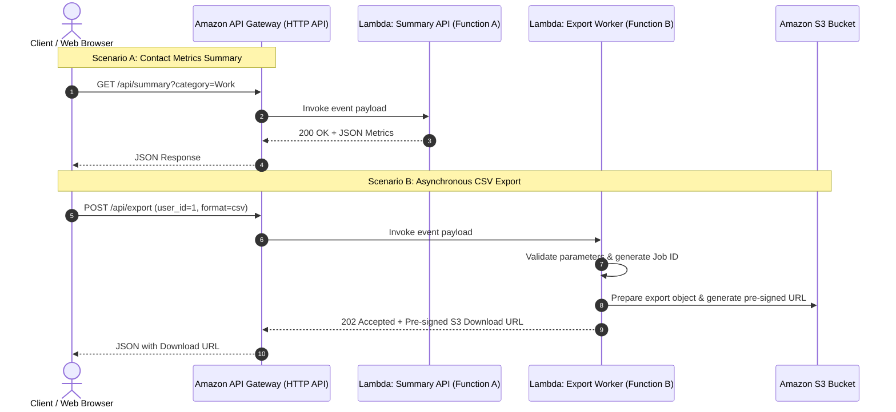

# Module 5 — Serverless Architecture using AWS Lambda & API Gateway

This guide covers **Module 5: Serverless Architecture** for the ContactHub BCA microproject, demonstrating how modern cloud native applications leverage **Serverless Computing**, **Function-as-a-Service (FaaS)**, and **Event-Driven Architectures**.

---

## 1. What is Serverless Architecture?

In traditional server-based architectures (IaaS and PaaS), developers manage virtual machines or container clusters that run 24/7, consuming resources and incurring costs even when idle.

In a **Serverless Architecture**:
1. **Zero Server Management:** Cloud providers (AWS, Azure, Google Cloud) automatically provision, execute, and scale compute resources.
2. **Pay-as-You-Go:** You are billed only for the exact milliseconds your code runs. Idle time costs $0.
3. **Auto-Scaling:** From 0 requests to tens of thousands of concurrent requests without manual capacity planning.

---

## 2. Serverless Component Breakdown in ContactHub



### 1. Function A: Contact Summary API (`serverless/lambda_function.py`)
- **Trigger:** HTTP `GET /api/summary`.
- **Purpose:** Generates safe, high-level summary metrics (total contacts, category distributions) for dashboard display without querying the monolithic backend directly.
- **Security:** Strict CORS headers, sanitized responses.

### 2. Function B: Contact Export Request (`serverless/contact_export_function.py`)
- **Trigger:** HTTP `POST /api/export`.
- **Purpose:** Validates export requests asynchronously, shielding the core web server from resource-heavy CSV generation during traffic spikes.
- **Security:** Validates `user_id`, enforces format constraints (`csv` or `json`), and outputs a time-limited Amazon S3 pre-signed URL expiring in 60 minutes.

### 3. AWS SAM Template (`serverless/template.yaml`)
- Declares the entire serverless cloud infrastructure as code (IaC): API Gateway HTTP API, Lambda functions, IAM roles, and S3 lifecycle storage rules.

---

## 3. Local Testing Without an AWS Account

You can verify and demonstrate the complete serverless architecture locally on your laptop without registering an AWS account:

```powershell
python serverless/test_local.py
```

### Verified Test Cases
1. `GET` request to Function A returning `200 OK` with JSON statistics.
2. Valid `POST` request to Function B returning `202 Accepted` with S3 download URI.
3. Missing `user_id` validation returning `400 Bad Request` (`MISSING_USER_ID`).
4. Unsupported format validation returning `400 Bad Request` (`INVALID_FORMAT`).

---

## 4. Optional Cloud Deployment via AWS SAM

If an active AWS account is available:

```powershell
# 1. Check AWS CLI and SAM CLI
aws --version
sam --version

# 2. Configure AWS credentials (do not commit keys to Git)
aws configure

# 3. Build SAM application
cd serverless
sam build

# 4. Deploy stack to AWS
sam deploy --guided
```

Once deployment completes, copy the generated endpoint URL and test live in PowerShell:

```powershell
curl.exe https://<api-id>.execute-api.<region>.amazonaws.com/api/summary
```

---

## 5. Security & Least Privilege

1. **IAM Policy Restrictions:** Lambda handlers are granted write access strictly to their specific S3 export bucket (`S3WritePolicy`).
2. **S3 Public Access Block:** Bucket blocks all public reads; downloads are permitted exclusively via cryptographic HMAC-signed URLs.
3. **Automatic Cleanup:** S3 lifecycle rules automatically delete generated export files after 7 days, eliminating cloud storage clutter.

---

## 6. Teardown / Cleanup Commands

To delete all AWS serverless resources:

```powershell
sam delete --stack-name contacthub-serverless
```
